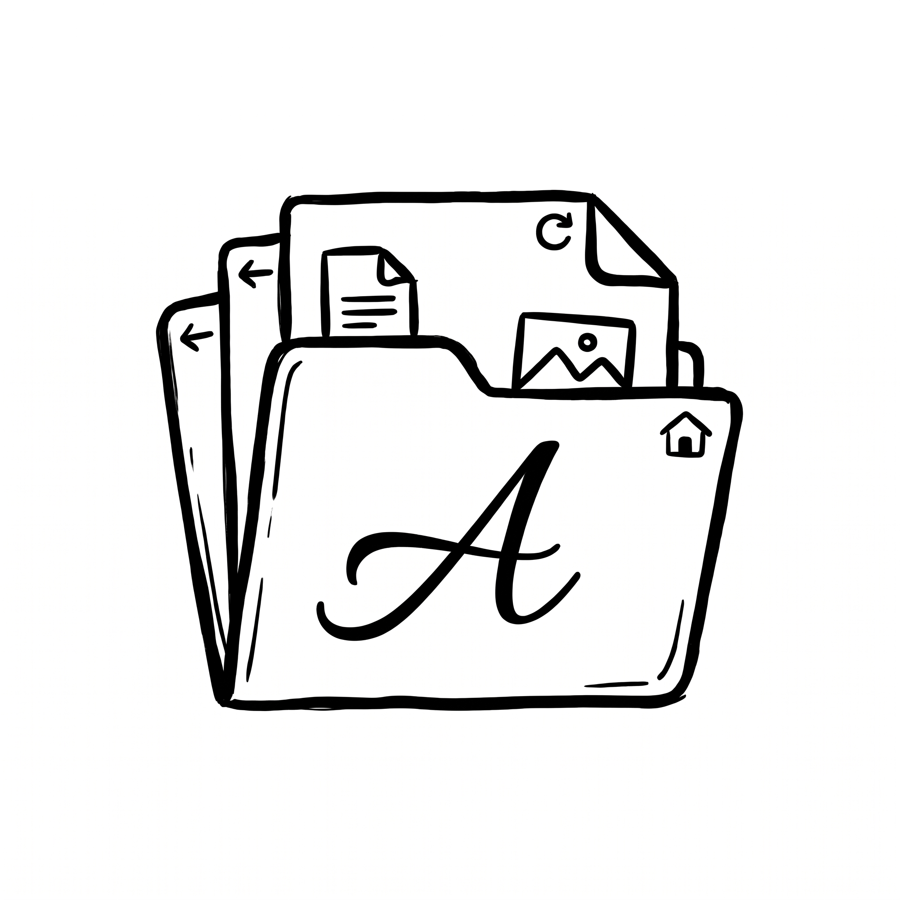
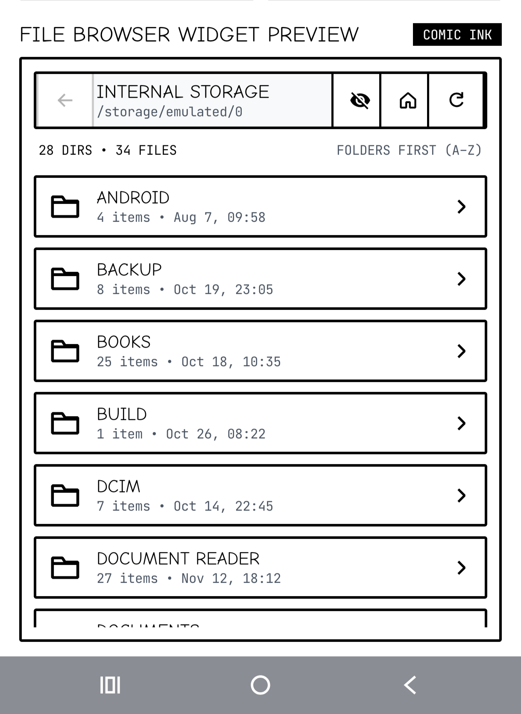
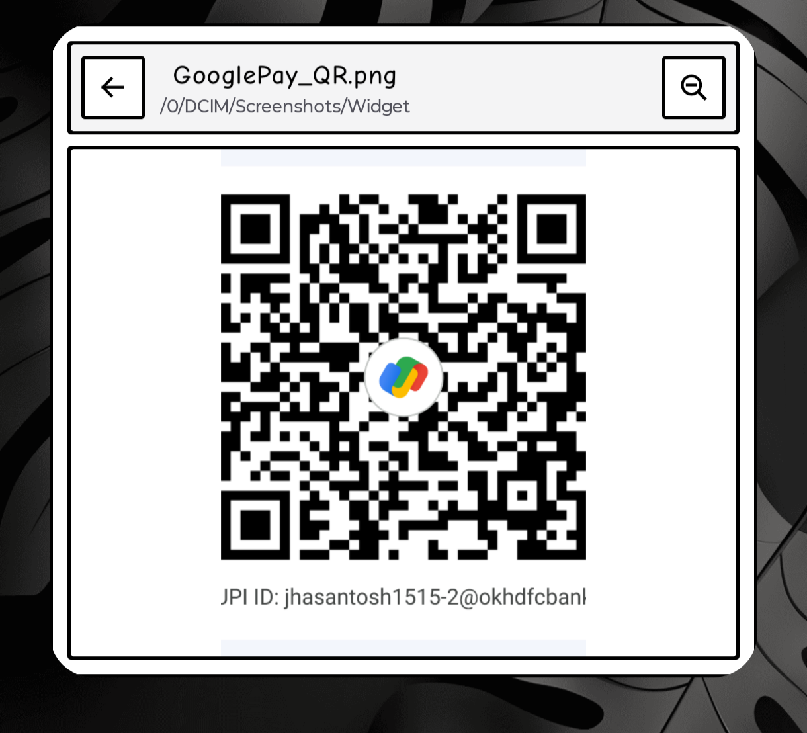

  
  <h1>Glance Files</h1>
  
A fast, monochrome <b>Comic Panel</b> Android Home Screen Widget & App for browsing files, viewing images, and reading code or Markdown right on your home screen.

---

## Preview

  
  &nbsp;&nbsp;
  

---

## Features

- **Home Screen File Browser:** Navigate folders and files directly from your Android home screen or in-app widget preview.
- **Built-In Image Viewer:** Tap any image (`.png`, `.jpg`, `.jpeg`, `.webp`) to display it inside the widget with **3-step (+20%) zoom in/out**, responsive widget resizing, and tap-for-fullscreen pinch-to-zoom.
- **Text, Code & Styled Markdown Reader:** Open `.txt` and source code files (`.java`, `.c`, `.kt`, `.py`, `.html`, `.json`, etc.) up to **1 MB** in a scrollable viewer, and view `.md` files with proper **Markdown styling**. Files above 1 MB offer a one-tap **File Picker**.
- **Format Badges:** Displays each file's format (`HTML`, `TXT`, `JAVA`, `MD`, etc., or `FILE` if longer than 5 letters).
- **Standalone APK Builds:** Automated GitHub Actions workflow builds standalone `arm64-v8a` and `x86_64` debug APKs and publishes them to GitHub Releases.
